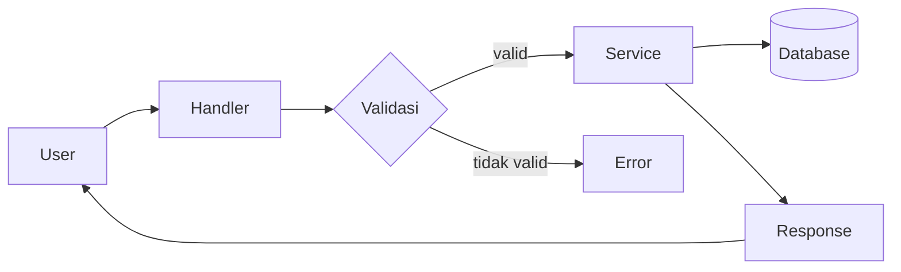
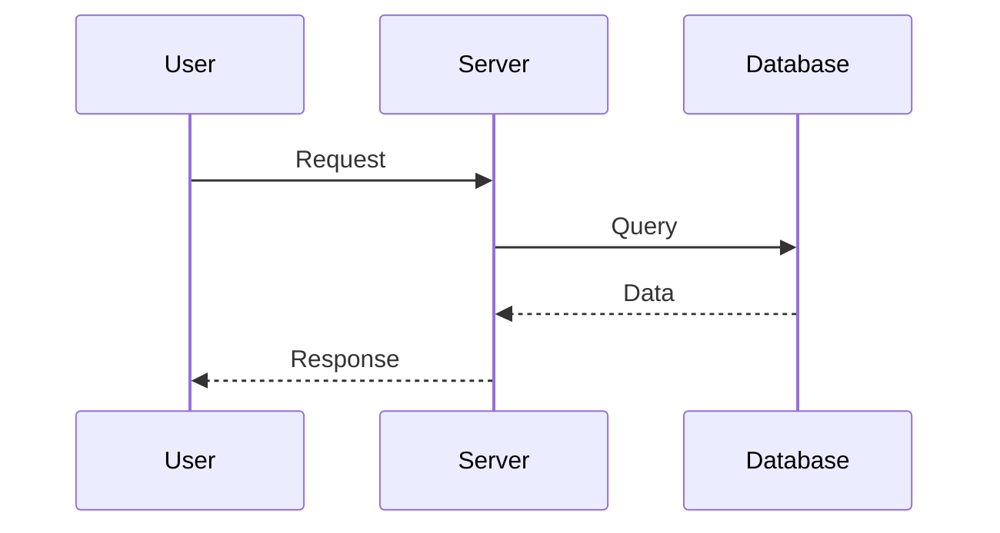

<a id="top"></a>

<div align="center">

<!-- Banner animasi teks (typing) -->
<a href="https://github.com/USERNAME/REPO">
  
</a>

<br/>

<!-- Badge dinamis (otomatis update dari GitHub) -->
<p>
  
  
  
  
  
</p>

<p>
  <a href="#-fitur">Fitur</a> •
  <a href="#-instalasi">Instalasi</a> •
  <a href="#-penggunaan">Penggunaan</a> •
  <a href="#-arsitektur">Arsitektur</a> •
  <a href="#-faq">FAQ</a> •
  <a href="#-kontribusi">Kontribusi</a>
</p>

<!-- Logo/screenshot beda untuk mode terang & gelap -->
<picture>
  <source media="(prefers-color-scheme: dark)" srcset="https://placehold.co/720x300/0d1117/36BCF7?text=Screenshot+Dark">
  <source media="(prefers-color-scheme: light)" srcset="https://placehold.co/720x300/ffffff/0969da?text=Screenshot+Light">
  
</picture>

</div>

---

## 📖 Daftar Isi

<details>
<summary><b>Klik untuk membuka / menutup</b></summary>

- [Fitur](#-fitur)
- [Instalasi](#-instalasi)
- [Penggunaan](#-penggunaan)
- [Konfigurasi](#-konfigurasi)
- [Arsitektur](#-arsitektur)
- [Roadmap](#-roadmap)
- [FAQ](#-faq)
- [Kontribusi](#-kontribusi)
- [Lisensi](#-lisensi)

</details>

---

## ✨ Fitur

- ⚡ **Cepat** — deskripsi singkat fitur utama
- 🔌 **Modular** — deskripsi singkat fitur kedua
- 🔒 **Aman** — deskripsi singkat fitur ketiga
- 🌐 **Multi-platform** — deskripsi singkat fitur keempat

> [!NOTE]
> Blok ini memakai *GitHub Alerts*. Tersedia: `NOTE`, `TIP`, `IMPORTANT`, `WARNING`, `CAUTION`.

---

## 🚀 Instalasi

Pilih sistem operasi kamu (klik untuk membuka):

<details>
<summary>🐧 <b>Linux / macOS</b></summary>

```bash
git clone https://github.com/USERNAME/REPO.git
cd REPO
npm install
cp .env.example .env
npm start
```

</details>

<details>
<summary>🪟 <b>Windows (PowerShell)</b></summary>

```powershell
git clone https://github.com/USERNAME/REPO.git
cd REPO
npm install
Copy-Item .env.example .env
npm start
```

</details>

<details>
<summary>📱 <b>Termux (Android)</b></summary>

```bash
pkg update && pkg upgrade -y
pkg install git nodejs -y
git clone https://github.com/USERNAME/REPO.git
cd REPO
npm install
npm start
```

</details>

<details>
<summary>🐳 <b>Docker</b></summary>

```bash
docker build -t nama-project .
docker run -d --env-file .env --name nama-project nama-project
```

</details>

> [!TIP]
> Setiap blok kode di GitHub otomatis punya tombol **Copy** di pojok kanan atas.

---

## 🎮 Penggunaan

```js
import { Project } from 'nama-project'

const app = new Project({ debug: true })
await app.start()
```

<details>
<summary>📋 <b>Daftar perintah</b></summary>

| Perintah | Fungsi | Contoh |
|----------|--------|--------|
| `/start` | Memulai bot | `/start` |
| `/help` | Menampilkan bantuan | `/help` |
| `/status` | Cek status layanan | `/status` |

</details>

Pintasan keyboard: <kbd>Ctrl</kbd> + <kbd>C</kbd> untuk menghentikan proses.

---

## ⚙️ Konfigurasi

Salin `.env.example` menjadi `.env`, lalu isi:

| Variabel | Wajib | Default | Keterangan |
|----------|:-----:|---------|------------|
| `API_KEY` | ✅ | – | Kunci API layanan |
| `PORT` | ❌ | `3000` | Port server |
| `DEBUG` | ❌ | `false` | Aktifkan log detail |

> [!WARNING]
> Jangan pernah commit file `.env` ke repository publik.

---

## 🏗️ Arsitektur

Diagram di bawah dirender langsung oleh GitHub (Mermaid):





---

## 🗺️ Roadmap

- [x] Rilis versi pertama
- [x] Dokumentasi dasar
- [ ] Dukungan plugin
- [ ] Dashboard web
- [ ] Unit test lengkap

---

## ❓ FAQ

<details>
<summary><b>Apakah project ini gratis?</b></summary>
<br>

Ya, dirilis dengan lisensi open source (lihat bagian [Lisensi](#-lisensi)).

</details>

<details>
<summary><b>Bagaimana melaporkan bug?</b></summary>
<br>

Buka [Issues](https://github.com/USERNAME/REPO/issues/new) dan sertakan langkah untuk mereproduksi masalahnya.

</details>

<details>
<summary><b>Node.js versi berapa yang didukung?</b></summary>
<br>

Node.js 18 ke atas.

</details>

---

## 🤝 Kontribusi

Kontribusi sangat diterima!

1. **Fork** repository ini
2. Buat branch: `git checkout -b fitur/nama-fitur`
3. Commit: `git commit -m "feat: tambah fitur"`
4. Push: `git push origin fitur/nama-fitur`
5. Buka **Pull Request**

### Kontributor

<a href="https://github.com/USERNAME/REPO/graphs/contributors">
  
</a>

---

## 📊 Statistik

<div align="center">


<br/><br/>

<a href="https://star-history.com/#USERNAME/REPO&Date">
  
</a>

</div>

---

## 📜 Lisensi

Didistribusikan di bawah lisensi **MIT**. Lihat file [`LICENSE`](LICENSE) untuk detail.

<div align="center">

**⭐ Jika project ini bermanfaat, beri bintang ya!**

<a href="#top">⬆️ Kembali ke atas</a>

</div>
